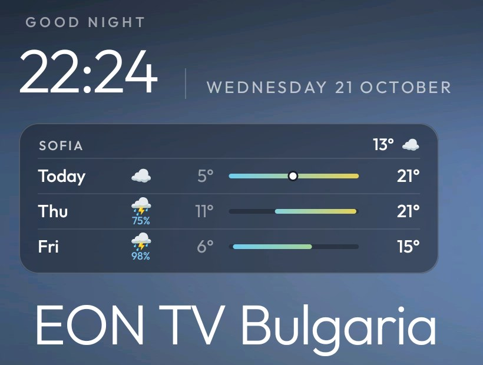
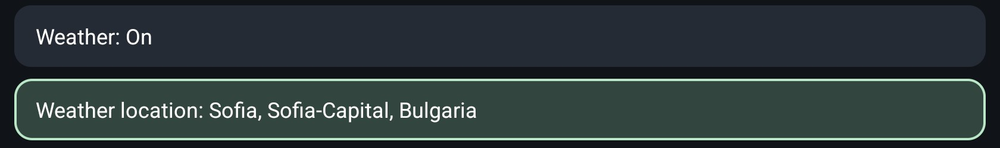
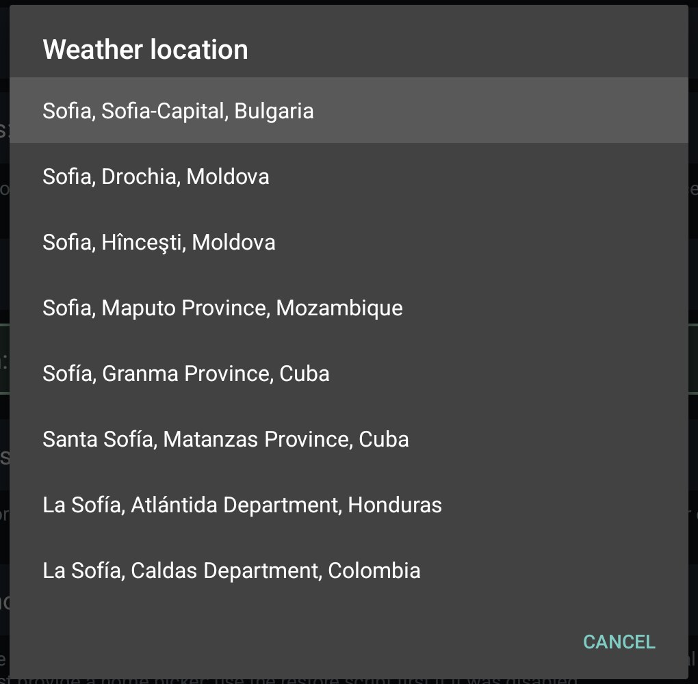

# Weather card and screensaver button

This branch of [cleanyourtv](https://github.com/Gathin23/cleanyourtv) adds two opt-in extras to its launcher,
plus one fix. Everything else is upstream unchanged. Both extras are **off by default**.



## Weather card

A glass card under the clock with the forecast for one place, laid out like Apple Weather's list. It shows
the current temperature, then a row each for today and the next two days:

- the day and a weather icon, with the chance of rain under the icon from 20%;
- the low, a range bar and the high;
- the three bars share one scale and are coloured cool to warm, and today's bar has a dot at the current
  temperature.

The card sits halfway between the clock and the app name above the dock, as wide as the longest dock app
name. It stays put whatever has focus, and fades out only while you scroll the grid up into its space.

**Turn it on from the TV:** on Home, hold OK on the Settings button and choose Launcher settings.

- **Weather: On / Off** switches the card.
- **Weather location** opens a search: type a city with the remote's keyboard and pick it from the list
  ("Sofia, Sofia-Capital, Bulgaria").

The choice is saved on the TV and survives reinstalls, theme pushes and "Follow theme".




**Or in `config.xml`** (or a theme's `config.json`), as the starting default:

```xml
<string name="weather_place" translatable="false">Sofia</string>
<string name="weather_latitude" translatable="false">42.6977</string>
<string name="weather_longitude" translatable="false">23.3219</string>
```

**Network.** This is the launcher's only network use, and it happens only while the card is on. It talks only to
[Open-Meteo](https://open-meteo.com), which is free and needs no key or account:

- **The forecast:** the place's latitude and longitude, at most once an hour and only while Home is in front.
- **The location search:** only the city name you type.

Nothing else is sent. With the card off, the launcher makes no requests. The last forecast is kept, so the card
shows it offline, with an "Updated 09:40" note once it is more than three hours old. The app declares `INTERNET`
for this card.

## Screensaver button

`screensaver_button` in `config.xml` adds a round moon button next to Settings that starts the TV's chosen
screensaver (Google Photos ambient mode, Clock, ...). On Google TV no ordinary app can start the screensaver
directly:

- the stock home does it with `WRITE_DREAM_STATE`, a permission only system apps can hold;
- SystemUI's public `Somnambulator` shortcut is a stub that does nothing.

So the button shortens the screen timeout for one start, and Android starts the screensaver itself. That
takes about **10 seconds** (Android's minimum idle time), and any key cancels it. Your own timeout comes
back as soon as the screensaver starts. `build-and-install.sh` grants the `WRITE_SETTINGS` app-op it needs.

## Fix: one press, one launch

With both remote helpers on (`INPUT_KEY_SERVICE=1` and `HOME_KEY_SERVICE=1`), a button mapped in `app_keys`
started its app twice, because each helper launched it. An app that restarts its player on a new launch,
such as a live-TV app, jumped back to live. `HomeKeyService` now leaves `app_keys` to `InputKeyService`
when both run.

## Tested on

TCL Smart TV Pro, device G08, Google TV 14 (`UTT2.250416.001 AU02`), with the TCL Bluetooth remote. Build and
install exactly as upstream (`launcher/build-and-install.sh`). On TCL sets, also allow `AUTO_START` once, as in
upstream's `docs/TROUBLESHOOTING.md`.
